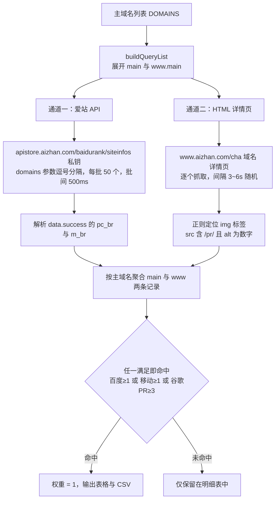
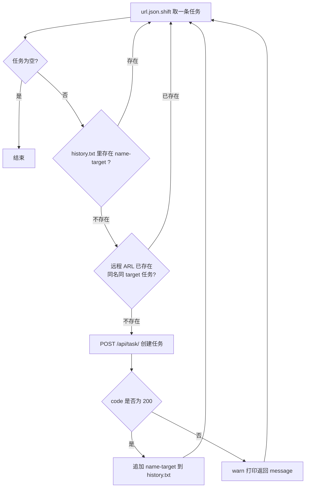

# scan-tools

一批用于**资产测绘与云资源巡检**的独立小脚本：批量筛域名权重、批量向 ARL 派发扫描任务、巡检阿里云 / 腾讯云账号下的 ECS 实例与账单。

每个目录彼此独立、可单独运行，没有统一的 CLI 入口，也不需要部署服务——填好凭证和清单，`node xxx.js` 就能跑。

---

> # 严禁用于任何危害性操作
>
> **本项目的全部脚本只允许用于「你自己拥有」或「已获得明确书面授权」的目标。**
>
> **严禁将本项目用于任何危害性操作。**任何未经授权的扫描、探测、入侵、提权、控制、数据窃取、篡改或破坏行为均属违法，可能触犯《网络安全法》《数据安全法》《刑法》第二百八十五条、第二百八十六条等规定。**由此产生的一切后果由使用者自行承担，项目作者不承担任何责任，也不提供任何形式的滥用支持。**
>
> **如果你无法确认自己是否已获得授权，请立即停止使用。**

| 绝对禁止 | 允许的前提 |
| --- | --- |
| 扫描、探测任何未授权的第三方资产 | 扫描自己公司/自己名下的资产 |
| 对目标实施入侵、提权、植入、留后门 | 持有书面授权（渗透测试合同、委托书、授权书）的测试 |
| 批量抓取、窃取、倒卖数据或个人信息 | 在 SRC / 众测平台**明确列出的范围**内测试 |
| 压测、DDoS、邮件/短信轰炸、恶意刷量 | 查询自己账号的云资源与账单 |
| 绕过授权、隐藏痕迹、规避审计 | 用自己申请的 API Key 做合法数据查询 |
| 将本项目或衍生工具用于上述行为的二次分发 | 学习、研究、内部合规审计 |

---

## 目录

- [严禁用于任何危害性操作](#严禁用于任何危害性操作)
- [它解决什么问题](#它解决什么问题)
- [功能一览](#功能一览)
- [目录结构](#目录结构)
- [环境要求](#环境要求)
- [安装](#安装)
- [快速开始](#快速开始)
- [模块详解](#模块详解)
  - [aizhan：域名权重批量筛查](#aizhan域名权重批量筛查)
  - [arl：ARL 扫描任务批量派发](#arlarl-扫描任务批量派发)
  - [ali-ecs：阿里云资源与订单巡检](#ali-ecs阿里云资源与订单巡检)
  - [tencent-ecs：腾讯云资源与账单巡检](#tencent-ecs腾讯云资源与账单巡检)
- [凭证管理](#凭证管理)
- [并发、限速与配额](#并发限速与配额)
- [安全与合规](#安全与合规)
- [已知限制](#已知限制)
- [FAQ](#faq)
- [License](#license)

---

## 它解决什么问题

安全与资产盘点工作中，最耗时的往往不是扫描本身，而是**扫描之前的准备工作**：

| 痛点 | 本项目的做法 |
| --- | --- |
| 拿到几千个域名，不知道哪些值得优先扫 | `aizhan` 按百度/移动权重、Google PR 三条线批量打分，只留下"有流量"的目标 |
| 手动在 ARL 里一个个建任务，点几百次鼠标 | `arl` 读清单自动建任务，并做**本地 + 远程双重去重**，可反复续跑 |
| 多个云账号、多个地域的机器散落各处，资产不清 | `ali-ecs` / `tencent-ecs` 拉全地域实例清单，跨地域一次性汇总 |
| 续费/到期失控，账单说不清 | `order.ts` 把订单和实例对账；腾讯云脚本直出余额与订单明细 |
| 收到一个来源不明的 AK，想先确认它属于谁 | `sms.ts` 用 STS `GetCallerIdentity` 验证 AK 有效性并回显账号身份 |

---

## 功能一览

| 模块 | 文件 | 语言 | 能力 | 外部依赖 |
| --- | --- | --- | --- | --- |
| `aizhan` | `index.js` | JS | 域名权重批量查询 + 阈值筛选 + CSV 导出 | 无（Node 18+ 原生 `fetch`） |
| `arl` | `arl.js` | JS (CJS) | ARL 任务批量创建、历史去重 | `axios` |
| `ali-ecs` | `src/client.ts` | TypeScript | 阿里云 10 个地域 ECS 实例清单 | 阿里云 ECS SDK |
| `ali-ecs` | `src/order.ts` | TypeScript | 实例 × 订单 对账（近 90 天） | 阿里云 ECS + BSS SDK |
| `ali-ecs` | `src/sms.ts` | TypeScript | AccessKey 有效性校验（STS） | 阿里云 STS SDK |
| `tencent-ecs` | `instances.js` | JS (ESM) | 腾讯云全地域 CVM 实例清单 | `tencentcloud-sdk-slim-nodejs` |
| `tencent-ecs` | `accountBalance.js` | JS (ESM) | 账户余额（可用/现金/赠送金） | 同上 |
| `tencent-ecs` | `dealsByCond.js` | JS (ESM) | 按时间段查订单明细 | 同上 |

---

## 目录结构

```
scan-tools/
├── aizhan/
│   └── index.js              # 域名权重筛查（API + HTML 双通道）
├── arl/
│   ├── arl.js                # ARL 任务批量派发
│   ├── url.json              # 任务清单输入（需自建）
│   └── history.txt           # 运行历史，用于去重（自动写入）
├── ali-ecs/
│   ├── src/
│   │   ├── client.ts         # 实例清单
│   │   ├── order.ts          # 实例 + 订单对账
│   │   └── sms.ts            # AK 校验（STS GetCallerIdentity）
│   ├── package.json
│   └── tsconfig.json         # tsc 编译到 dist/
├── tencent-ecs/
│   ├── instances.js
│   ├── accountBalance.js
│   └── dealsByCond.js
├── package.json              # 根依赖（汇总所有 SDK）
└── README.md
```

---

## 环境要求

- **Node.js 18+**（`aizhan` 依赖全局 `fetch`）
- 建议 **Node.js 22+**：`tencent-ecs/*.js` 使用 ESM `import` 语法，但 `tencent-ecs/package.json` 未声明 `"type": "module"`，Node 22 的语法自动探测可直接运行；在 18/20 上需补 `"type": "module"` 或改名为 `.mjs`。
- **pnpm**（仓库声明 `packageManager: pnpm@12.18.0`，用 npm / yarn 也能装）
- 阿里云模块需 `tsc` 编译，产物在 `ali-ecs/dist/`（已被 `.gitignore` 忽略）

---

## 安装

根目录安装（覆盖 `aizhan`、`arl`、`tencent-ecs` 的依赖）：

```bash
pnpm install
```

`ali-ecs` 带有独立的 `package.json` 与 lock 文件，若需运行 TypeScript 模块，再装一次：

```bash
cd ali-ecs && pnpm install && cd ..
```

---

## 快速开始

| 目标 | 命令 |
| --- | --- |
| 筛域名权重 | 编辑 `aizhan/index.js` 顶部 `AIZHAN_PRIVATE_KEY` 与 `DOMAINS` → `node aizhan/index.js` |
| 批量建 ARL 任务 | 准备 `arl/url.json`，填 `TOKEN` → `node arl/arl.js` |
| 阿里云实例清单 | 填 `ali-ecs/src/client.ts` 的 AK → `cd ali-ecs && npx tsc && node dist/client.js` |
| 阿里云实例×订单对账 | 同上，运行 `node dist/order.js` |
| 校验 AK | 同上，运行 `node dist/sms.js` |
| 腾讯云实例清单 | 填 `tencent-ecs/instances.js` 的 `secretId/secretKey` → `node tencent-ecs/instances.js` |
| 腾讯云余额 | `node tencent-ecs/accountBalance.js` |
| 腾讯云订单 | `node tencent-ecs/dealsByCond.js` |

> 所有脚本的凭证目前都在**文件顶部常量**里（见[凭证管理](#凭证管理)）。跑之前先确认已经改成自己的，别把带 AK 的文件提交上去。

---

## 模块详解

### aizhan：域名权重批量筛查

**目标**：从一堆域名里挑出"有真实流量"的，作为后续扫描的优先目标。

**双通道设计**——因为爱站的两个数据源各有短板：结构化 API 只给百度/移动权重，Google PR 只能从详情页 HTML 里抠。



**判定规则**（`main` 与 `www` 任一命中即算通过）：

- 百度权重 ≥ 1
- 移动权重 ≥ 1
- Google PR ≥ 3

**配置项**（`aizhan/index.js` 顶部）：

| 常量 | 说明 | 默认 |
| --- | --- | --- |
| `AIZHAN_PRIVATE_KEY` | 爱站 API 私钥（[apistore.aizhan.com](https://apistore.aizhan.com/) 申请） | 空，必填 |
| `DOMAINS` | 主域名数组，无需带 `www.` | `[]` |
| `API_BATCH_SIZE` | 单次 API 请求的域名数 | 50 |
| `HTML_DELAY_MIN/MAX` | HTML 抓取随机间隔（毫秒） | 3000 / 6000 |

**输出**：

1. 控制台 `console.table` 打印全量结果（含未命中项，便于排查）；
2. 控制台 `console.table` 打印命中域名及 `命中项`（如 `主域名(百度>=1); www(谷歌>=3)`）；
3. 浏览器环境下自动下载 `qualified_any_weight.csv`（带 UTF-8 BOM，Excel 直接打开不乱码）；Node 环境仅打印表格。

**实现细节**：

- API 业务码 `200000` 视为成功，非该码整批计入失败；API 未返回的域名同样计入 `failed`。
- 单条 HTML 失败不影响整体，该域名 PR 记为 `null`，仍参与百度/移动判定。
- 异常信息保留 HTTP 状态码，便于区分封禁与网络问题。

---

### arl：ARL 扫描任务批量派发

面向 [ARL](https://github.com/TophantTechnology/ARL)（灯塔）的批量建任务脚本：给它一份"单位名 + 域名"清单，它会按固定策略一次性打满。

> **该模块会发起主动扫描，严禁对未授权目标使用。** 详见[严禁用于任何危害性操作](#严禁用于任何危害性操作)。脚本启动时也会打印同样的授权提示。

**输入 `arl/url.json`**：**直接粘贴域名备案管理系统查询结果中的 `list` 节点内容**即可，无需裁剪字段。

```json
[
  {
    "contentTypeName": "",
    "domain": "example.com",
    "domainId": 110000250920,
    "leaderName": "",
    "limitAccess": "",
    "mainId": 3978547,
    "mainLicence": "京ICP备00000000号",
    "natureName": "企业",
    "serviceId": 0,
    "serviceLicence": "京ICP备00000000号-20",
    "unitName": "某某科技有限公司",
    "updateRecordTime": "2019-11-20 17:35:01"
  }
]
```

脚本只消费其中两个字段，其余字段会被忽略：

| 字段 | 用途 |
| --- | --- |
| `unitName` | 任务名（`name`），同时用于本地 `history.txt` 去重 |
| `domain` | 扫描目标（`target`） |

> 注意：`url.json` 必须是**顶层的 JSON 数组**，不是 `{ "list": [...] }` 包装对象。备案系统完整响应通常是 `{ code, msg, data: { list: [...] } }`，请只取 `list` 的值。


**去重是双层的**——这是脚本的核心逻辑：



- **本地去重**：`history.txt` 每行 `单位名-域名`，创建成功后 `appendFileSync` 追加，天然支持断点续跑。
- **远程去重**：`GET /api/task?name=&target=` 带 `token` 头，`total >= 1` 且 `items` 中能精确匹配 `target` 才认为存在——避免换机器重跑时重复建任务。

**扫描策略**（`createTask` 中固定开启，按需改）：

```js
domain_brute: true,  domain_brute_type: 'big',   // 大字典子域爆破
port_scan:   true,  port_scan_type:  'all',      // 全端口
service_detection: true, os_detection: true,     // 服务/系统识别
ssl_cert: true, alt_dns: true, dns_query_plugin: true,
arl_search: true, search_engines: true, site_spider: true,
site_identify: true, findvhost: true, file_leak: true,
web_info_hunter: true, skip_scan_cdn_ip: true,
site_capture: false, nuclei_scan: false           // 默认关闭，按需开
```

**配置项**：

| 常量 | 说明 |
| --- | --- |
| `POSTURL` | ARL 建任务地址，默认占位 `https://domain/api/task/`，改成你的 ARL 域名 |
| `TOKEN` | ARL 登录后 cookie 中的 token |
| `taskIsExist` 内的 URL | 默认 `http://arl.myjerry.cn/api/task`，同样需替换 |

> `site_capture`（站点截图）和 `nuclei_scan` 默认关闭：前者依赖浏览器环境较慢，后者噪音大、建议确认资产后再单独跑。

---

### ali-ecs：阿里云资源与订单巡检

三个独立入口，均为 TypeScript，`tsc` 编译后运行 `dist/` 下的产物。

**`client.ts` — 实例清单**

遍历 10 个地域（杭州、上海、青岛、北京、张家口、呼和浩特、深圳、河源、成都、中国香港），`DescribeInstances` 每页 100 条，打印主机名、实例 ID、CPU、内存、规格、系统、状态。

**`order.ts` — 实例 × 订单对账**

三者中逻辑最完整的一个，解决"这台机器属于哪张订单、花了多少钱、什么时候到期"：

1. 先用 BSS `QueryOrders` 拉近 **90 天**全部订单，`NextToken` 翻页，按 `ResourceInstanceId` 建索引 Map；
2. 再逐地域 `DescribeInstances`（同样 `NextToken` 翻页），用 `instanceId` 反查订单；
3. 输出 `计费类型 / 订单号 / 订单金额 / 到期时间`，按量付费或无订单的实例明确标注。

```ts
// 关键点：BSS 端点固定杭州，regionId 与 endpoint 需分别设置
bssConfig.regionId = 'cn-hangzhou';
bssConfig.endpoint = 'business.aliyuncs.com';

// 关键点：DescribeInstancesRequest 必须显式传 regionId
new $ECS.DescribeInstancesRequest({ pageSize: 100, regionId, NextToken: ecsNextToken });
```

**`sms.ts` — AccessKey 校验**

> 文件名与内容不符（历史遗留），实际做的是 **STS 身份校验**。

调用 `sts.aliyuncs.com` 的 `GetCallerIdentity`，成功则打印 `AccountId / Arn / UserId`，失败则输出 `error.code` 与 `error.message`，可区分是 ID 写错、Secret 写错还是子账号权限不足。

```bash
npx tsc            # 编译到 dist/
node dist/sms.js
```

---

### tencent-ecs：腾讯云资源与账单巡检

三个 ESM 脚本，均基于 `tencentcloud-sdk-slim-nodejs`（按产品分包的精简 SDK，比完整包小得多）。

**`instances.js` — 全地域实例清单**

先用广州地域的 client 调 `DescribeRegions` 拿全量地域，再对每个地域并发 `DescribeInstances`，用 `Promise.allSettled` 保证**单地域失败不影响整体**；结果逐条打印 `实例ID | 名称 | 状态 | 公网 IP`，失败地域单独打错误。

**`accountBalance.js` — 账户余额**

`DescribeAccountBalance` 返回值单位是**分**，脚本已换算为元：

```js
const balanceYuan = data.Balance / 100               // 可用余额
const cashYuan    = data.CashAccountBalance / 100    // 现金余额
const presentYuan = data.PresentAccountBalance / 100 // 赠送金余额
```

**`dealsByCond.js` — 订单明细**

`DescribeDealsByCond` 按 `StartTime/EndTime` 查订单，`Limit/Offset` 翻页，输出产品名、子产品、状态、金额、下单时间。注释里留了 `Status: 4`（只看已发货）的开关。

```js
client.DescribeDealsByCond({
  StartTime: '2026-08-01 00:00:00',
  EndTime:   '2026-10-01 00:00:00',
  Limit: 20, Offset: 0,
})
```

---

## 凭证管理

当前脚本的凭证都写在文件顶部常量里，**这是为了"复制即用"的临时做法**，开源使用请改成环境变量，至少不要提交：

```bash
# .env 已被 .gitignore 忽略
export ALI_AK_ID="..."
export ALI_AK_SECRET="..."
export TENCENT_SECRET_ID="..."
export TENCENT_SECRET_KEY="..."
export ARL_TOKEN="..."
```

```js
const credential = {
  secretId: process.env.TENCENT_SECRET_ID,
  secretKey: process.env.TENCENT_SECRET_KEY,
}
```

**最小权限建议**：

| 用途 | 需要的权限 |
| --- | --- |
| 阿里云实例清单 | `ecs:DescribeInstances` |
| 阿里云订单对账 | 上述 + `bss:QueryOrders` |
| 阿里云 AK 校验 | `sts:GetCallerIdentity` |
| 腾讯云实例 | `cvm:DescribeInstances`、`cvm:DescribeRegions` |
| 腾讯云账单 | `billing:DescribeAccountBalance`、`billing:DescribeDealsByCond` |
| ARL 建任务 | ARL 自身 token，不需要云凭证 |

除 ARL 建任务外全部是**只读接口**，建议使用子账号 + 只读策略，并开启操作审计。

---

## 并发、限速与配额

- **爱站 API**：按调用量计费，`API_BATCH_SIZE = 50` 是单次上限，脚本在批次间固定 `500ms` 间隔；域名很多时注意账户额度。
- **爱站 HTML**：无官方配额，但**反爬敏感**。脚本用 3~6 秒随机间隔 + 浏览器 UA + `Accept-Language` 降低触发风控的概率。这是"能跑通"与"被封 IP"之间的关键参数，**不建议调小**。
- **阿里云 / 腾讯云**：`Describe*` 接口有限流（QPS 级别），本项目调用量（几十次）远低于阈值；若扩展到多账号循环，建议串行并加延时。
- **腾讯云并发**：`instances.js` 对所有地域**同时**发起请求（`Promise.allSettled`）。地域数量通常在 20 以内，可接受；若要更保守，改成 `for` 循环 + `await` 即可。

---

## 安全与合规

> **再重复一次：本项目严禁用于任何危害性操作。**
>
> 完整的使用边界见文档开头的[严禁用于任何危害性操作](#严禁用于任何危害性操作)。如果你只是"想试试能不能扫"，那就不在允许范围内。

**逐模块风险提示**：

| 模块 | 风险动作 | 使用前提 |
| --- | --- | --- |
| `arl` | 子域爆破、全端口扫描、服务识别、漏洞探测（nuclei） | **必须是书面授权的目标**。未授权扫描在中国大陆及其他多数司法辖区均可能构成违法 |
| `aizhan` | 高频抓取第三方站点详情页 | 遵守目标站点 robots 协议与服务条款，保持 3~6s 间隔，勿调小 |
| `ali-ecs` / `tencent-ecs` | 读取云账号资源与账单 | 仅限**你本人拥有或被授权管理**的账号；`sms.ts` 用于验证 AK 归属，不得用于他人在未授权情况下"试探"的凭证 |

**其他合规要求**：

- 仓库中不应出现真实 AK/SK、token、客户域名清单。`history.txt`、`url.json` 若含敏感项目信息，提交前请清空或加入 `.gitignore`。
- 扫描前建议留存授权证明（授权书、合同、SRC 范围截图），并对自己的操作留痕（时间、目标、参数），便于事后自证合规。
- 发现漏洞后应遵循**负责任披露**：先报给资产所有者，不公开细节、不利用、不交易。
- 因滥用本工具造成的一切直接或间接损失，作者不承担责任，亦不提供任何滥用协助。

---

## 已知限制

如实列出，避免踩坑：

| 位置 | 限制 |
| --- | --- |
| `aizhan` | 爱站 API 单批上限 50，域名上千时耗时以小时计（HTML 通道占大头）；Google PR 依赖详情页 HTML 结构，改版即失效 |
| `aizhan` | CSV 导出依赖浏览器 `document` / `Blob`，Node 下只打印表格 |
| `arl` | 通过 `main()` 递归推进队列且**未 await**，清单规模大时存在递归压力，建议改为 `while` 循环 |
| `arl` | 建任务后不轮询任务状态，成功与否只看创建接口返回码 |
| `ali-ecs/client.ts` | 未做 `NextToken` 翻页，单地域**最多只取前 100 台**；`order.ts` 已实现翻页，可参照补齐 |
| `ali-ecs/sms.ts` | 文件名与功能不一致（实为 AK 校验）；`.ts` 中混用 CJS `require`，依赖 `esModuleInterop` 才能编译 |
| `tencent-ecs` | 未声明 `"type": "module"`，低版本 Node 直接运行会报 `Cannot use import statement` |
| 全局 | 无统一 CLI、无参数解析、无配置文件、无日志落盘；输出仅控制台 |
| 全局 | 凭证硬编码在源码中 |

---

## FAQ

**Q：`aizhan` 报"请先填入爱站 API 私钥"？**
`AIZHAN_PRIVATE_KEY` 仍是占位值。另外请注意代码里的判断字符串是 `"YOUR_PRIVATE_KEY_HERE"`，直接留空**不会**触发该提示，但请求会失败——请填真实私钥。

**Q：`aizhan` 的谷歌 PR 全是 0 或 null？**
两种可能：爱站详情页结构变化导致正则 `` 匹配失败；或请求被风控拦截（`HTML HTTP 403`）。先手动打开 `https://www.aizhan.com/cha/example.com/` 确认页面是否正常。

**Q：`arl` 跑了没反应？**
`url.json` 为空数组或空文件时 `shift()` 返回 `undefined`，脚本静默退出。确认文件是顶层 JSON 数组且至少有一条记录（可 `node -e "console.log(require('./arl/url.json').length)"` 自检）。

**Q：阿里云报 `Forbidden.RAM`？**
子账号缺少对应 `Describe*` / `QueryOrders` 权限，按[最小权限建议](#凭证管理)授权。

**Q：腾讯云余额数字明显偏小？**
接口单位是分，脚本已 `/100`；如果自己改过代码，检查是否漏了换算。

**Q：能商用吗？**
代码以 ISC 协议开源，但**使用行为的合法性由使用者承担**，尤其是 `arl` 的扫描动作。

---

## License

ISC
